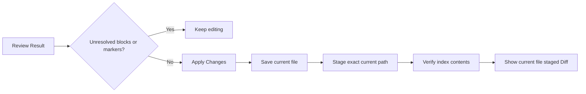

# Git 审查与三方合并

Leader 为 `,`。审查、历史与合并统一使用 CodeDiff **4.0.8**；普通源码中的变更标记和块操作保留 Gitsigns。界面使用英文，参考 IDEA 的合并术语；这是 Neovim 终端展示，并非 IDEA 的原生图形组件。

## 安装与版本

配置入口为 `lua/user/plugins/git.lua`。CodeDiff 使用本地目录 spec，源码和原生库不随配置仓库提交，也没有绑定在 lazy-lock 中；必须安装匹配版本。

新机器上先确认下列目标目录不存在，避免覆盖已有安装，然后从上游固定 tag 安装源码：

```bash
(
set -eu
test ! -e "$HOME/.local/share/nvim/lazy/codediff.nvim"
mkdir -p "$HOME/.local/share/nvim/lazy/codediff.nvim"
curl -fL https://codeload.github.com/esmuellert/codediff.nvim/tar.gz/refs/tags/v4.0.8 -o /tmp/codediff-v4.0.8.tar.gz
tar -xzf /tmp/codediff-v4.0.8.tar.gz --strip-components=1 -C "$HOME/.local/share/nvim/lazy/codediff.nvim"
)
```

若目标已有安装，先核对并备份，不要直接执行覆盖操作。重启 Neovim 后运行 `:CodeDiff install` 安装匹配平台的原生 diff 库。上游：[安装说明](https://github.com/esmuellert/codediff.nvim#installation)。本配置适配固定版本内部 API，升级前须重新验证三方合并、鼠标、撤销和退出清理。

## 分支审查

| 入口 | 行为 |
| --- | --- |
| `,gd` | 打开 CodeDiff；存在 Git 未合并文件时进入冲突/工作区列表 |
| `,gB` / `:CodeDiffBase` / 点击 Base | 选择本地分支或远端跟踪引用作为比较基准 |
| Enter | 目录展开/折叠；文件打开单文件完整 Diff |
| `Ctrl+d` / `Ctrl+f` | 当前文件下一/上一变更块，不自动滚入下一个文件 |
| `gd` / `Ctrl+o` | 沿用已有 LSP 跳转/返回；历史修订侧不保证具有完整项目语义 |
| `,w` | 最大化当前拆分，再按恢复；保留期间的光标和跳转结果 |
| `,gc` / `q` | 关闭视图，保留未完成与未保存确认 |
| `,gh` / `,gH` | CodeDiff 当前文件/项目历史 |

选择基准：按`,gB`（大写B），输入分支名过滤，用↑/↓或Ctrl+n/p选中，Enter确认，Esc取消。`,gb`（小写b）是Checkout分支，含义不同。合并未完成时更换比较基准会另开普通审查，保留原合并Result；不会把正在合入的Git分支改成新选择。

普通分支审查比较所选引用的 **tip 到最终工作区**，不是 merge-base，也不只看未提交修改；包含已提交、暂存、未暂存、未跟踪以及新增/删除/重命名。Git 自身忽略的文件不强制纳入。默认基准 `origin/master`，可按仓库选择其他引用；选择仅在当前会话记忆，不 checkout、不自动 fetch。

普通审查为 Changes 目录树；合并状态区分 Merge Conflicts、Staged Changes、Local Changes。目录只用 Enter 折叠，`h/l` 保留移动含义。

## 合并操作

直接在任意合并代码窗按 `m` 打开 Merge 菜单，快按下面的两键操作也可直接执行。它们仅在合并视图接管，退出后恢复原有普通窗口映射（包括 Vim mark）。

| 快捷键 | 英文动作 | 范围 |
| --- | --- | --- |
| `ml` / `mr` | Resolve using Left / Right | 当前冲突块，按实际屏幕左右判断 |
| `ma` | Accept Both | 当前块保留双方 |
| `mu` | Reset to Base | 当前块恢复祖先，重新变为未解决 |
| `mL` / `mR` / `mA` / `mU` | 整文件接受左/右/双方/还原 | 确认后执行；还原包含已处理块，其余只处理未解决块 |
| `mz` / `mZ` | Undo / Redo | 中间 Result 的编辑历史 |
| `u` / `Ctrl+r` | Undo / Redo | 同样作用于 Result，支持次数并限制初始边界 |
| `Ctrl+d` / `Ctrl+f` | Next / Previous Change | 当前文件全部变更：未处理/已处理冲突、自动合并与手工修改；首尾停止，不自动切文件 |
| `mf` / `,gmf` / 点击 Apply Changes | Apply Changes | 保存并标记当前文件已解决 |

三列使用各自当前行号定位同一批变更，接受、手改、Undo/Redo后重新计算位置；不会因为冲突已处理就跳过。导航只移动光标，不修改、保存或暂存代码。

未解决块旁 `→/←` 可点击接受对应输入侧。已处理的勾选/忽略标记为状态展示；需要更换选择时，先 `mu` 还原或 `mz` 撤销。

## 如何读来源标记

| Result 标记 | 说明 |
| --- | --- |
| `L✓` / `R✓` | 有操作记录的 Accepted Left / Right |
| `B✓` | 有操作记录的 Accepted Both，包括一侧为空的情况 |
| `E~` | Edited，结果不匹配已知输入或组合 |
| `!` | Unresolved，仍等于该块祖先 seed 或跟踪无效 |
| `L=` / `R=` / `B=` / `?=` | Matches：当前内容匹配输入/组合，或两侧都匹配；不冒称按钮操作历史 |

接受侧为绿色勾选，忽略侧为灰色叉号；待处理块淡红并保留接受箭头，手改淡蓝，Matches 使用青色。每块有 gutter 来源码与行尾标签，当前块在 winbar 显示完整状态。窄窗中行尾文字可能不可见，仍可看 gutter 和当前块标题。

来源记录只存哈希和角色，每个当前文件最多 64 个 undo 序列；未知手改、重新打开或超出记录范围时保守使用 Matches/Edited。Undo/Redo 回到已记录状态后恢复 Accepted 标签。背景和标签使用独立 namespace，不改源码、不新增虚拟行、不清除原生 diff/filler/tracking；只在徽标数据变化时强制刷新，避免空侧残留旧箭头。

## 保存、完成与退出



若提示Result窗口变化，说明中间窗当前展示的不是此合并会话跟踪的Result buffer。`mf`先恢复原Result并提示复核；不会自动保存或暂存。确认内容后再按`mf`。被替换窗口原来展示的buffer及其未保存修改继续保留。

`:w` 只保存，不代表 Git 已解决。Apply Changes 会检查未处理块与残留冲突标记，正常保存 Result，精确暂存当前路径，再核对该路径没有未合并阶段且暂存内容匹配保存结果；其他文件不被一并暂存。完成后该文件从 Merge Conflicts 移到 Staged Changes，显示普通 Diff；若结果等于 HEAD，可能没有 staged 条目。

保存失败或暂存失败保留视图供重试；保存成功但暂存失败时，磁盘已保存，不能声称保存已回滚。关闭未完成视图会提示，默认取消；原生未保存结果仍保留 Discard/Cancel 守卫。

本入口不执行 commit、merge --continue、rebase --continue 或 abort。Undo/Redo 只撤销 Result 编辑，不能撤回已完成的 Git 暂存，也不能恢复 Git 三阶段索引。

## 配置职责与验证

| 文件 | 职责 |
| --- | --- |
| `lua/user/plugins/git.lua` | CodeDiff 目录 spec、原生历史与审查入口 |
| `lua/user/codediff_review.lua` | 基准选择、会话键位、英文分组及关闭提示 |
| `lua/user/codediff_merge_controls.lua` | 块旁箭头、gutter、winbar、撤销边界与清理 |
| `lua/user/codediff_merge_finish.lua` | 当前文件保存/暂存校验、错误处理、回审查 |
| `lua/user/codediff_merge_presentation.lua` | 来源分类、受限操作记录、配色与装饰 |
| `lua/user/keymaps.lua` / `whichkey.lua` | 窗口缩放与菜单说明 |

已在合成本地仓库验证：分支累计变更、单文件上下文、基准选择、块旁点击、空侧与多行、左右换位、手改和 Undo/Redo；完成流程覆盖未完成拒绝、单文件保存/暂存、保存失败、索引锁失败重试及返回当前文件；视觉验证覆盖五类状态的实际文字、RGB、来源码和空侧刷新。

这不是所有平台/主题的兼容保证。配置仓库只发布通用源码和文档，不包含工程样本、运行截图、日志、依赖缓存、本机服务或认证信息。

## 历史与普通源码操作

`,gh` 为当前文件历史，`,gH` 为项目历史，均打开原生 CodeDiff history。文件路径含空格和从审查窗口进入历史均已在独立本地仓库验证。普通源码里的 `Ctrl+d/f`、`Ctrl+u`、行/文件 blame 由 Gitsigns 提供；CodeDiff 的 gutter 与块操作只作用于 Diff 视图，不等于普通源码全局 Git 标记。
